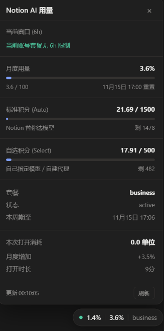

# notion-desktop-panel

给 **Notion 桌面版** 加一个常驻的 **AI 用量悬浮条**，同时把「Notion 云端 AI 读写你本机文件」这条链路做成 **开 Notion 自动起、关 Notion 自动停** 的一体化方案。

> Windows 10/11 · Notion 桌面版 7.4x（Electron 45 / Chrome 156 实测）· Node.js 22+ · 零 npm 依赖



## 它解决什么问题

1. **Notion 不给你看清楚用量**。设置页只有一个笼统百分比，6h 窗口 / 月度 / 标准积分 / 自选积分混在一起。这里把每一项摊开，并且**只显示你账号真实存在的那几项**。
2. **改 `app.asar` 的改法活不过一次升级**。本项目不改安装目录，走 Electron 自带的 **CDP 调试协议** 注入，Notion 升级后重新注入即可。
3. **Notion 云端 AI 碰不到本机**。搭配本地 MCP 服务 + Cloudflare 隧道，让 Notion 里的 Agent 能读写你电脑上的文件、跑命令、走 git。
4. **服务要手动开、关掉还赖在后台**。这里把 MCP 服务与隧道的生命周期绑到 `Notion.exe` 上：开着才有，全关了自动收干净。

## 两个部分

| 部分 | 作用 | 依赖 |
|---|---|---|
| **面板（本仓库主体）** | CDP 注入 `panel.js`，画出用量悬浮条 + 展开卡片 | Node.js 22+，零依赖 |
| **本地 MCP（可选）** | 让 Notion 云端 AI 操作本机文件 / shell / git | 上游 [notion-local-ops-mcp](https://github.com/catoncat/notion-local-ops-mcp) + Cloudflare 隧道 |

只想要用量面板，**跳过 MCP 那一步也能直接用**。

## 功能

**悬浮条**（右下角胶囊，点击展开卡片）

```
● 1.4% ｜ 3.6% ｜ business
  ↑      ↑      ↑
标准积分  月度   套餐
```

- 顺序：**6h 用量（仅账号受 6h 限速管时出现）｜标准积分用量｜月度用量｜套餐**
- 圆点颜色按最吃紧的那一项变色（≥70% 黄、≥90% 红），取数失败变红
- 每一项都带 tooltip 显示真实数值（如 `11.91 / 1500`）

**展开卡片**

- 当前窗口（6h）用量、重置倒计时
- 月度用量、重置日期
- **标准积分（Auto）**：Notion 替你选模型时扣的那份
- **自选积分（Select）**：自己指定模型 / 自建代理时扣的那份
- 套餐名、订阅状态、本周期截止
- 本次打开消耗（用额度增量反推）
- 最近几次变化时间点

**自适应**

- 账号没有 6h 限速 → 6h 那格连同分隔线一起隐藏，卡片里改显示「当前账号套餐无 6h 限制」
- 没有标准积分（如个人免费空间）→ 标准积分那格自动隐藏
- 7.42 及更早的 `window` / `billingPeriodWindow` 旧结构与 7.43+ 的 `allowances[]` 新结构都支持

## 快速开始（只要面板）

```powershell
git clone https://github.com/<you>/notion-desktop-panel.git
cd notion-desktop-panel
node launch.mjs
```

`launch.mjs` 会：

1. 探测 Notion 安装位置（`%LOCALAPPDATA%\Programs\Notion\Notion.exe` 等常见路径，或用 `NOTION_EXE` 指定）
2. 若 `127.0.0.1:9223` 上已有 Notion 在响应，直接注入，**不重启**你的 Notion
3. 否则先结束所有 `Notion.exe`，再带 `--remote-debugging-port=9223` 重新拉起（Notion 是单实例，不带端口启动的实例会静默吃掉参数）
4. 连上 CDP，对所有 Notion 分页注入 `panel.js`，并注册 `Page.addScriptToEvaluateOnNewDocument`，**Ctrl+R 刷新后也还在**
5. 监视 `panel.js`，改完保存即自动重新注入

只想手动注入、不想被管理启动流程：

```powershell
# 先自己用调试端口起 Notion
& "$env:LOCALAPPDATA\Programs\Notion\Notion.exe" --remote-debugging-port=9223
node inject.mjs
```

## 完整方案（面板 + 本机文件互通）

看 **[docs/setup-mcp-tunnel.md](docs/setup-mcp-tunnel.md)**，分四步、每步都有验证命令和失败判据：

1. 确认 Notion 账号支持「自定义 MCP 连接」
2. 部署本地 MCP 服务（`127.0.0.1:8766`，Bearer 鉴权）
3. 建 Cloudflare 隧道把 MCP 暴露出去（Notion 云端必须公网可达）
4. 注册连接 + 让服务随 Notion 启停

MCP 服务端本身是上游项目，本仓库只提供 **中文 Windows 下的补丁**（见下）。

## 让服务跟着 Notion 走（可选但推荐）

| 文件 | 角色 |
|---|---|
| `launch.vbs` | 用 `wscript` 无窗口跑 `launch.mjs`；快捷方式指向 `wscript.exe "launch.vbs"` |
| `services.vbs` | 用 `wscript` 无窗口跑 `services.mjs`，**脱离控制台** |
| `services.mjs` | 服务看护进程：只在 `Notion.exe` 存在时才拉起 MCP + cloudflared |

生命周期规则（`services.mjs`）：

- `Notion.exe` 不在 → 完全不启动隧道（没开 Notion 就不占资源）
- `Notion.exe` 在 → 看护 MCP 与 cloudflared，掉线 5 秒内补起
- `Notion.exe` 消失满 **25 秒** → 收掉两者后自行退出（留宽限是为了躲开 Notion 更新时的短暂重启）

> 为什么不是「看启动器」而是「看 Notion」：启动器会在注入器已在运行时提前退出，也会被用户手动关掉，用它判断会让隧道中途断线。
>
> 为什么必须 `process.exit(0)` 而不是直接 `return`：只要子进程还活着，Node 的事件循环就不会退出，`exit` 钩子里的清理永远不执行 —— 这是很容易漏的坑，本项目踩过并修好了。

**不注册任何开机 / 登录自启**：两个计划任务都设为仅手动触发，只有你点快捷方式才会有服务。

### 计划任务（自己按需建）

```powershell
schtasks /Create /TN NotionPanelLaunch  /TR "\"C:\Windows\system32\wscript.exe\" \"<插件目录>\launch.vbs\""   /SC ONCE /ST 00:00 /F
schtasks /Create /TN NotionMcpServices /TR "\"C:\Windows\system32\wscript.exe\" \"<插件目录>\services.vbs\"" /SC ONCE /ST 00:00 /F
```

建完把触发器删掉即可变成「仅手动」。快捷方式指向：

```
目标：C:\Windows\system32\wscript.exe
参数："<插件目录>\launch.vbs"
起始位置：<插件目录>
图标：沿用 Notion 自己的图标
```

## 配置项（全部可选）

| 环境变量 | 默认 | 说明 |
|---|---|---|
| `NOTION_EXE` | 自动探测 | Notion 可执行文件路径 |
| `NOTION_DEBUG_PORT` | `9223` | CDP 端口（9222 常被别的 Electron 应用占用） |
| `SERVICES_MCP_DIR` | `../notion-local-ops-mcp` | MCP 服务端目录 |
| `SERVICES_MCP_PYTHON` | `<MCP_DIR>/.venv/Scripts/python.exe` | MCP 用的 Python |
| `SERVICES_MCP_PORT` | `8766` | MCP 端口 |
| `SERVICES_CLOUDFLARED` | `../cloudflared/cloudflared.exe` | cloudflared 路径 |
| `CLOUDFLARE_TUNNEL_TOKEN` | — | 隧道 token；也可写进 `tunnel.token`（已 gitignore） |
| `SERVICES_NOTION_IMAGE` | `Notion.exe` | 判定「Notion 在不在」用的映像名 |
| `SERVICES_IDLE_EXIT_MS` | `25000` | Notion 关闭多久后收工 |
| `SERVICES_STARTUP_GRACE_MS` | `90000` | 启动后等 Notion 出现的上限 |
| `SERVICES_DRY_STOP` | — | 设 `1` 则只记录不真删（调试验证用） |

**隧道 token 不写进源码**：优先读 `CLOUDFLARE_TUNNEL_TOKEN`，其次读同目录 `tunnel.token`。两样都没有就只跑 MCP、不启动隧道。

## 给上游 MCP 打的补丁

`patches/notion-local-ops-mcp/`

上游在中文 Windows 上有个会**静默吞掉输出**的 bug：`subprocess.run(..., text=True)` 按 `cp936` 解码，子进程只要吐出任何非 GBK 字节（UTF-8 中文、emoji、二进制残留），读取线程抛 `UnicodeDecodeError`，`stdout` 直接变 `None` —— 工具表面返回成功，内容整段消失。

补丁做法：一律先取 bytes，再按 `utf-8 → gb18030 → utf-8(replace)` 降级解码，永不抛异常。涉及 `shell.py` / `gitops.py` / `files.py`，新增 `outdecode.py`。

```powershell
cd <你的>/notion-local-ops-mcp
cp <本仓库>/patches/notion-local-ops-mcp/outdecode.py src/notion_local_ops_mcp/
git apply <本仓库>/patches/notion-local-ops-mcp/utf8-output.patch
```

## 已知限制

- **拿不到单次 token / 首字延迟**。Notion 桌面版的推理走 Electron 主进程，不经过页面网络栈，CDP 够不着。代码里保留了对 `/runInferenceTranscript` 的 NDJSON 拦截，但在被主进程代理的部署下无效，因此卡片改用「额度增量」反映消耗。
- **6h 重置时间是近似值**。真实窗口是滑动的，接口不给固定 `periodEnd`，面板按「现在 + 6h」估算。
- **6h 是否适用靠判定字段推断**。`status` / `allowances[].state` / `enforcement` 三者含义不同，代码里分开读，不合并成一个布尔。
- **Notion 升级后可能需要重新接管一次**。Notion 用 `--updated` 自重启时新进程不带调试端口，`launch.mjs` 会自动重新接管（最多 6 次，避免反复重启）。

## 排错

先看日志（都在插件目录下，已 gitignore）：

```
notion-panel.log   注入器：连上哪个 target、注入结果、断线原因
services.log       服务看护：MCP / cloudflared 启停记录
```

| 现象 | 原因 |
|---|---|
| 开了 Notion 但 9223 连不上 | 已有不带端口的实例吃掉了参数；`launch.mjs` 会先杀干净再带端口起 |
| 面板不显示 | 当前分页不是 `app.notion.com`；或注入后 Ctrl+R 之前的旧文档 |
| 面板显示「未取到 spaceId」 | 该分页 URL 与 localStorage 都没有 space uuid；换到有 `?spaceId=` 的分页 |
| 隧道起来就 401 | MCP 没读到 `.env`；`services.mjs` 会显式解析 .env 并注入环境变量 |
| MCP 反复退出（code=3） | Python 的 `USERPROFILE` 缺失；`services.mjs` 会补齐 home 相关变量 |
| 关 Notion 后隧道还在 | 看 `services.log` 有没有「已關閉滿 25 秒」；早期 `return` 写法会让清理永不执行 |

## 致谢 / 基于什么做的

- **注入思路**：[LeoHsxg/notion-bar-fix](https://github.com/LeoHsxg/notion-bar-fix) —— 原生 CDP 注入而非改 `app.asar`，升级不失效。本仓库 `LICENSE` 沿用其 MIT 版权声明。
- **本地 MCP 服务端**：[catoncat/notion-local-ops-mcp](https://github.com/catoncat/notion-local-ops-mcp)（MIT，24 个工具，含 `delegate_task` 可把重活转给本地 codex / claude-code）。本仓库不重新分发其代码，只提供补丁。
- **公网接入**：Cloudflare Tunnel（Zero Trust，免费计划够用）。

## License

MIT，见 [LICENSE](LICENSE)。上游衍生部分保留原作者版权声明。
